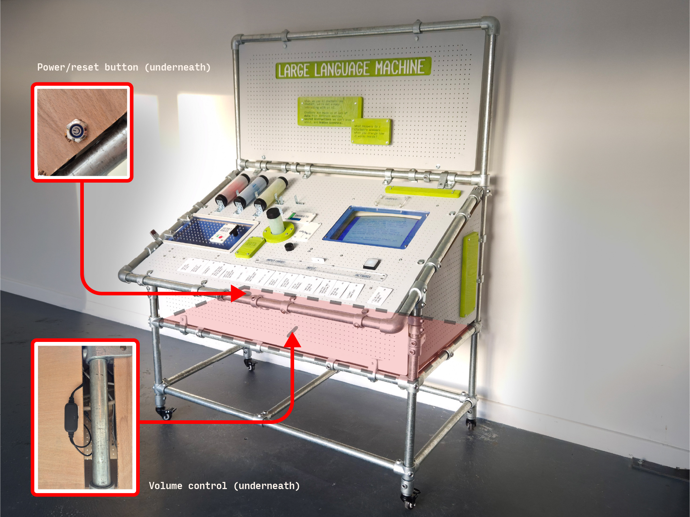

[< Large Language Machine user guide](Guide.md)
# Getting started

    
  
## Powering on:    
1. Turn on power at both plug sockets (marked *1. Compute* and *2. Readers*).    
2. Press the power button, concealed at the rear left of the machine underneath the lower panel.    
3. A test screen will appear on-screen. Each sensor connects as soon as its reader and the router have booted, which can take up to 2 minutes. On the test screen, 🔌 means a reader isn't connected yet and ❌ means it's connected but hasn't read anything yet. A "🔌 Button not connected" line shows until the button's reader connects.   
4. Once the button lights up, test each sensor:   
    - Turn the *Randomness* knob   
    - Place *Secret Rule* spheres in their bucket   
    - Insert a *Question* card (or if a card is already inserted, remove it and reinsert)   
    - Insert a *Dataset* tube (or if there's a tube already in, remove it and resinsert)   
5. Once all the checks are passed on screen, press the button to begin.   
6. Set the right volume for the environment using the concealed control underneath.   
   
## Powering off:    
1. Press the power button.   
2. Once the screen is off, wait 5 seconds then turn off power at both plug sockets.   
   
## Quick restart:    
1. Press the power button.   
2. Once the screen is off, wait 5 seconds.   
3. Hit the power button again.   
4. Startup checks will appear on screen, you can complete them straight away and press the button.   
   
## Full reboot (~3 min required):    
1. Press the power button.   
2. Once the screen is off, wait 5 seconds.   
3. Turn off both power sockets.   
4. **IMPORTANT** Wait 10-15 seconds to let the readers *completely* power down.   
5. After waiting 10-15 seconds, turn on both power sockets.   
6. Press the power button again.   
7. Complete startup checks once the sensors have connected (up to 2 minutes).

---

Next: [Using the machine >](Usage.md)