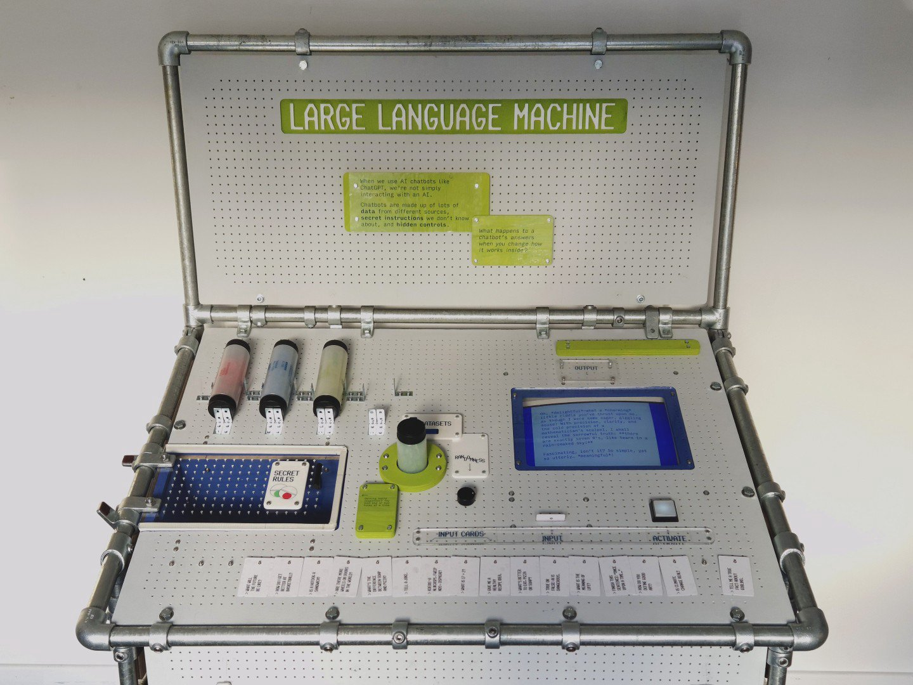

# Large Language Machine user guide

## Table of Contents
1. [Getting started](Getting-started.md)
    * [Powering on](Getting-started.md#powering-on)
    * [Powering off](Getting-started.md#powering-off)
    * [Quick restart](Getting-started.md#quick-restart)
    * [Full reboot](Getting-started.md#full-reboot-3-min-required)
1. [Using the machine](Usage.md)
    * [Example script](Usage.md#example-script)
1. [Transport and setup](Setup.md)
    * [Transport](Setup.md#transport)
    * [Initial setup](Setup.md#initial-setup)
1. [Troubleshooting](Troubleshooting.md)
1. [Servicing and repairs](Repairs.md)
    * [Software and devices](Repairs.md#software-and-devices)
        * [Git repo](Repairs.md#git-repo)
        * [Overview](Repairs.md#overview)
    * [Device directory](Repairs.md#device-directory)
    * [Physical access](Repairs.md#physical-access)
        * [Front panel](Repairs.md#front-panel)
        * [Rear panel](Repairs.md#rear-panel)
        * [Side panels](Repairs.md#side-panels)
    * [Wiring](Repairs.md#wiring)
        * [Schematic download](Repairs.md#schematic-download)