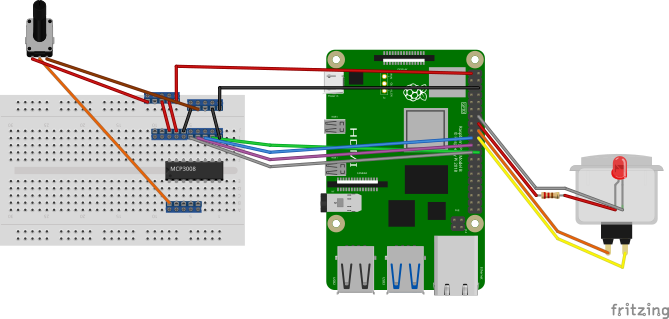

# Servicing and repairs

## Software and devices

### Git repo
All the software is located at https://git.grpahicdeisgn.com/nathan/large-language-machine.git. This is a self-hosted Git server so please don't rely on it long-term, I'd recommend cloning the repo to your own server.

### Overview
Everything is run through Python scripts. The main machine ("Inference") hosts an [MQTT](https://mqtt.org/) server and an instance of [Ollama](https://ollama.com), and auto-launches `large-language-machine.py` on boot. This main python script collates MQTT messages from each reader to compile a prompt, and then sends that prompt to Ollama, and displays the results on the output screen.

Each reader is a Raspberry Pi which runs its own scripts (except the RFID readers which both run the same `rfid-read.py` script), which are launched and maintained by systemd services (each of which is located in /Scripts).

The best way to access each device is by connecting to the internal offline wifi network (managed by the router inside the machine, with the SSID `Large Language Machine`) and ssh using the IP addresses below. There's also a mouse and keyboard stored internally for accessing the PC's desktop interface. Press F11 to exit the full-screen terminal and ctrl-C to kill the Large Language Machine script. The desktop is the same blue as the terminal which can be confusing, you need to press the Super key or move the mouse to the dock on the right hand side to find some GUI.

## Device directory
| Device                      | Name        | IP           | Main script(s)                   | Systemd service(s)                        |
|-----------------------------|-------------|--------------|----------------------------------|-------------------------------------------|
| Main server PC              | Inference   | 192.168.1.10 | `large-language-machine.py`      | `launch-ll-machine.service`               |
| UHF Reader (Secret Rules)   | Pi5-01      | 192.168.1.11 | `uhf-read.py`                    | `read-uhf.service`                        |
| RFID Reader (Dataset tubes) | piZero2W-02 | 192.168.1.12 | `rfid-read.py`                   | `read-rfid.service`                       |
| Button and knob reader      | piZero2W-01 | 192.168.1.13 | `buttond-read.py`, `pot-read.py` | `read-button.service`, `read-pot.service` |
| RFID Reader (Question cards)| piZ-03      | 192.168.1.14 | `rfid-read.py`                   | `read-rfid.service`                       |

## Physical access

### Front panel
* Using a 7mm allen key, loosen the two brackets on the left and right which hold the small front panel. You can then lift the front panel up over its lower brackets, pull it towards you and lift it out. This allows you to access the knob/button wiring and the UHF reader.
### Rear panel
* Using a 7mm allen key, loosen the two brackets at the top of the rear panel, and it'll rotate on its lower hinges. This lets you access the main PC, the CRT monitor and the Dataset tube reader.
### Side panels
* Using a 7mm allen key, loosen the single bracket on the front (smaller) end of the side panel. You also might need to loosen the two hinges on the rear side to allow it to swing open like a door. The left side lets you access the wifi router and PC, the right side lets you access the CRT monitor and button/LED wiring.

## Wiring
The potentiometer, button and button LED all connect to piZero2W-01 via screw terminals and a perma-proto board. Everything should be easily replaceable without soldering if any wiring fails, the only exceptions being the direct connections to the pot and button/LED contacts.

### Schematic download
* [llm-wiring-diagram-v01.fzz](files/llm-wiring-diagram-v01.fzz)
