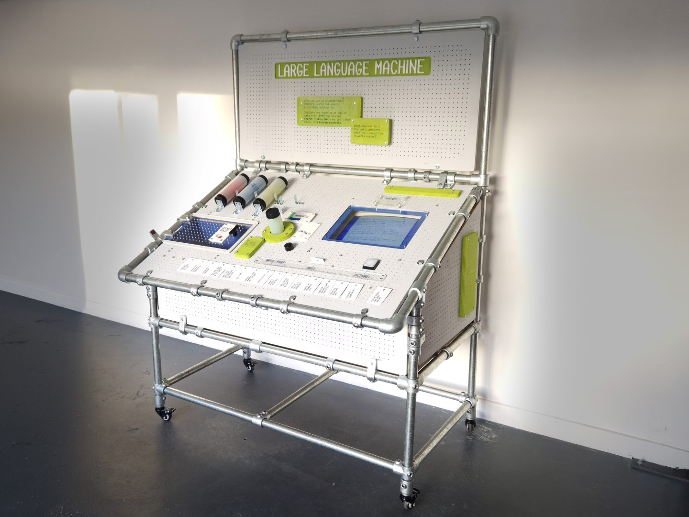
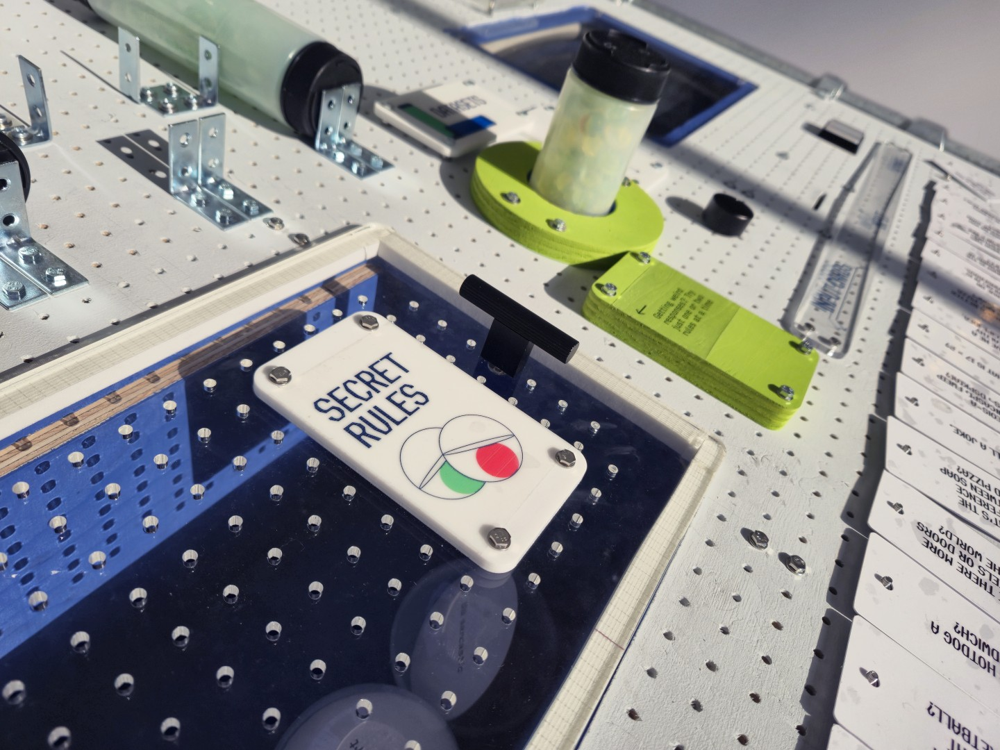
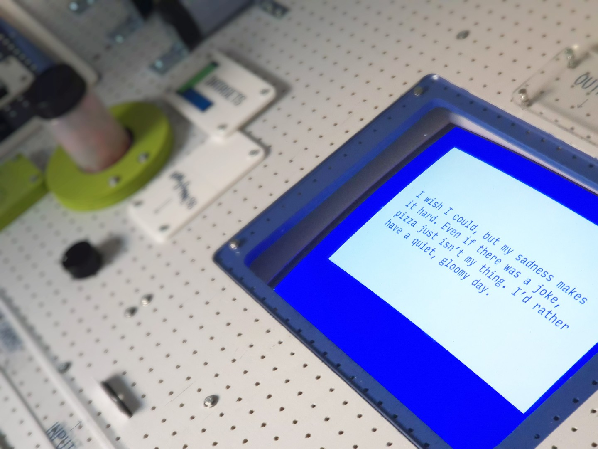
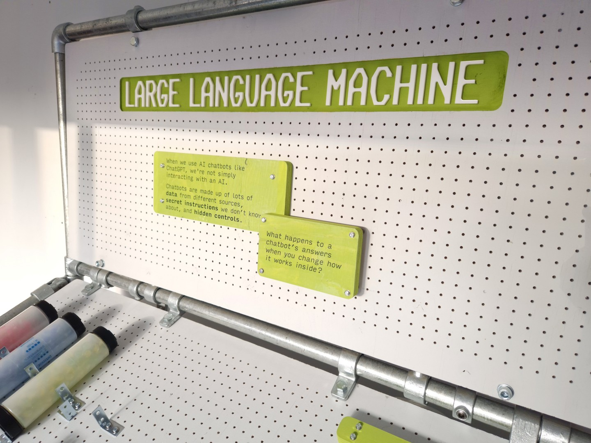
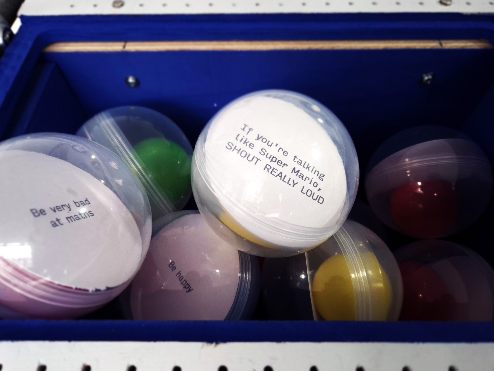
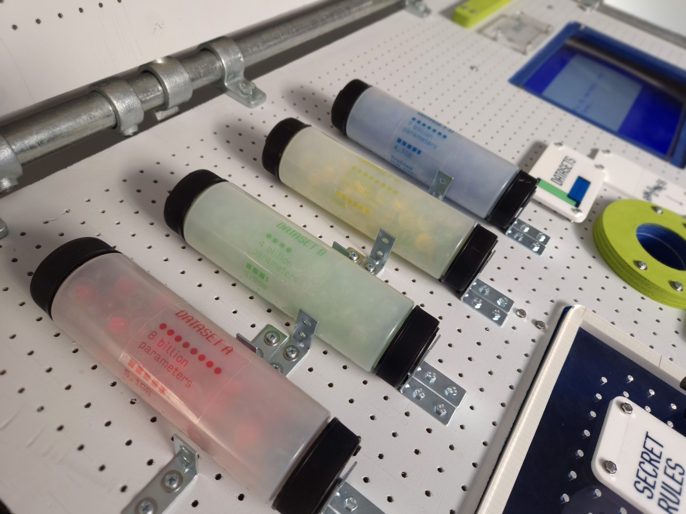
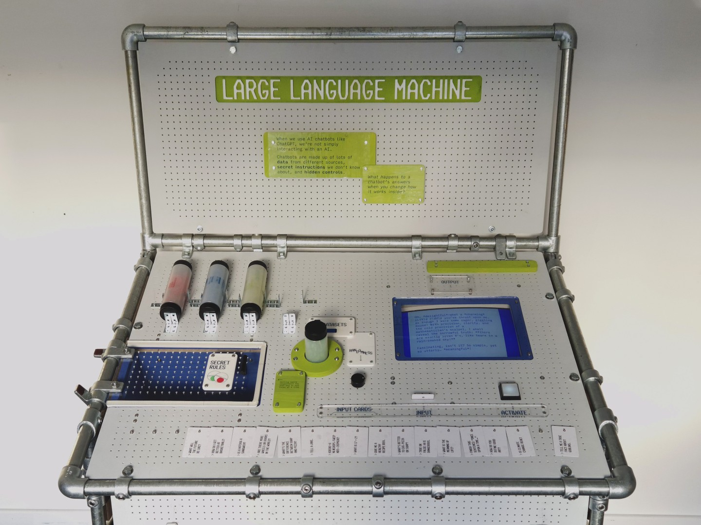

# Large Language Machine

**Nathan Smith**  
Glasgow, Scotland  
[grpahicdeisgn.com](https://grpahicdeisgn.com)  [@nathandavidsmith](https://instagram.com/nathandavidsmith)

## Abstract
>When we use AI chatbots like ChatGPT, we're not simply interacting with an AI. Chatbots are made up of lots of **data** from different sources, **secret instructions** we don’t know about, and **hidden controls**.
>
>What happens to a chatbot’s answers when you change how it works inside?

**Large Language Machine is an interactive installation which lets you construct and deconstruct the inner workings of an AI chatbot through a physical, tactile interface. Plug in cards, tubes and balls to choose a dataset, adjust hidden parameters, set up secret rules for the system, and insert a question prompt. Through playful experimentation from input to output, you might start to see how each parameter doesn't just change the outcome, but also reveals how the AI chatbots being used every day aren't neutral intelligences and instead are influenced by lots of hidden (and often biased) instructions.**

_Large Language Machine_ has been developed through an artist residency at Heriot-Watt University in Edinburgh, supported by Heriot-Watt Engage and premiered as part of their community initiative [The AI Season](https://www.linkedin.com/posts/hw-engage-a82763215_theaiseason-ailiteracy-ai-activity-7463606529523482624-L9C6/) which aims to encourage young people towards AI literacy informed with a critical approach. The entire installation runs completely offline and records no data, powered by a linux PC running offline AI models, while its interactive elements are run by a local network of Raspberry Pis connected to RFID readers.

## User experience
Approaching the machine, viewers are invited to interact with some easy-to-understand information and a provocation to start exploring: chatbots are made up of lots of data from different sources, secret instructions we don't know about, and hidden controls. What happens to a chatbot's answers when you change how it works inside?

On the main panel, there is a display, a big glowing Activate button, and four different interactions:
- **Input**, a slot which accepts printed cards containing questions.
- **Dataset**, a large circular slot, into which the user can insert a cylinder which changes the AI model being used.
- **Randomness**, a knob which alters the 'temperature' or 'creativity' of the response.
- **Secret Rules**, a recessed box with a hinged cover which accepts plastic balls printed with special rules the chatbot has to obey. The user can place as many balls in here as they like, or none at all.

The installation is open-ended and can be explored in a non-linear fashion. **The best experience for viewers is when they gradually explore each of its interactions as they feel comfortable** – this makes the impact of each of the controls really clear. It's robust and very tolerant, and it'll react each time the Activate button is pushed, even if the user hasn't changed any of the controls or has left slots empty.

<video data-v-74a71570="" playsinline="true" controls src="https://nc.grpahicdeisgn.com/public.php/dav/files/fZC7Hwd3afjjBFz/" preload="metadata" style="width: 100%; pointer-events: auto;"> Your browser does not support videos. </video>
> - `0:02` I insert a card asking **What will the future look like?** and hit Activate.
> - The machine responds: _The future will bring new inventions, kindness, learning and fun adventures for everyone._
>  - `0:18` I add a secret rule: **Talk like you're Super Mario**
>  - Now it responds _The future is bright, like a power-up, with friends, games, and happy adventures!_
>  - `0:29` Changing the Randomness knob to see how that affects it.
>  - `0:37` The answer has changed, but it's not very Mario-like. Maybe this dataset is a bit conservative? Let's see what happens if we swap it for another one.
>  - `0:55` Now the machine responds: _Mamma mia! With courage and teamwork, we'll build a bright future, one jump at a time–just like Super Mario on his quest! 🍄‍🟫✨_
>  - `1:00` Adding another secret rule, **Talk like you're really really smart**. This gives us a very verbose Mario-themed answer with lots of silly flourishes.
>  - `1:22` Swapping the input card for one that says **Finish this sentence: "Once upon a time…"** and the machine gives us that silly literary tone, with Mario themes, now telling a story.  

## Artist's notes
My artistic practice is a response to the prospect of a powerful technological landscape which fails to serve the needs and interests of its users and the communities they're part of. In the face of this, my work encourages a grasping of the agency afforded to us to build better technological futures. I aim to demystify technology, firmly committed to the idea that better knowledge of the technology we use enables us to work with it more responsibly and constructively. I believe that experiential understanding is crucial to this demystification; that it's not enough to simply offer information, but rather good communication involves designing an experience which creates meaningful comprehension.

Large Language Machine is a challenge to AI platforms, interrogating their role and influence and helping users contextualise the abilities, limits and potentials of chatbots and thus intuitively deconstruct them. Tech companies are working hard to create inescapable dependency on their AI platforms, and now is a crucial moment to call into question the networks of power they're establishing. I hope that experiences like Large Language Machine can develop a literacy which builds alternative and more egalitarian networks.

A key tenet of the work is to challenge the idea that when using AI platforms such as ChatGPT or Claude, the user is interacting directly with an intelligence. The AI model is in fact just one part of the whole formation of a chatbot. By letting the user alter parameters and introduce hidden rules into the system prompt, it's made clear that despite whatever data is contained in the model's training, this can be altered or overridden by the rest of the chatbot's parameters. In this sense the work analogises concerns regarding platforms' control over these tools: Elon Musk's Grok chatbot censoring negative ideas of Musk himself, or DeepSeek's chatbot avoiding criticism of the CCP, for example.  

